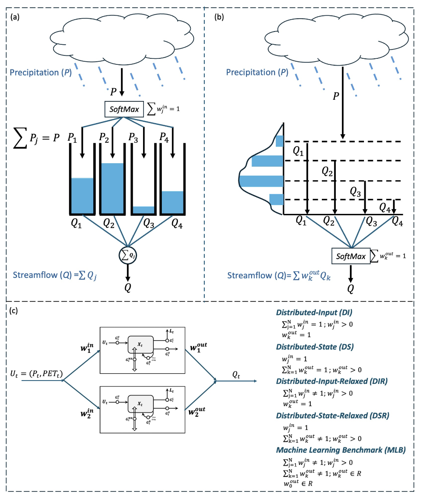

## Mass-Conserving Perceptron (MCP) Neural Network Model Zoo

This repository provides a curated and documented implementation of the neural-network architectures developed in Wang & Gupta (2025), all built around the mass-conserving perceptron (MCP) as the fundamental computational unit, as illustrated in Figure 1.


*Figure 1. A neural-network architecture built from mass-conserving perceptrons.*

The original research code was archived at [Zenodo](https://doi.org/10.5281/zenodo.15811866); the version presented here has since been streamlined, refactored, and reorganized for improved readability, reproducibility, and reuse, with assistance from OpenAI's ChatGPT (GPT-6.1 Sol, Max intelligence mode).

Note that this repository includes only the results for the Leaf River Basin and is intended primarily for pedagogical and demonstration purposes. Users interested in reproducing or extending the analyses to the CAMELS-US catchments are encouraged to follow the methodology described in Wang & Gupta (2025) and use the scripts provided in the original [Zenodo](https://doi.org/10.5281/zenodo.15811866).

---

## Quick Start

### Requirements

Use Python 3.10 and install the dependencies listed in `requirements.txt`, including NumPy, pandas, PyTorch, and scikit-learn. Run the following command from the repository root:

```bash
python -m pip install -r requirements.txt
```

### Leaf River Data

The example data are provided in `20220527-MDUPLEX-LeafRiver/`, the default data directory used by the training and evaluation scripts.

- `LeafRiverDaily_43YR.txt`: daily precipitation (`P`), potential evapotranspiration (`PET`), and streamflow (`Q`), in that column order and all in mm/day.
- `LeafRiverDaily_43YR_Flag.txt`: flags identifying the data subsets used for model spin-up, training, selection, and testing.

| Flag | Data subset |
| ---: | :--- |
| `-99999` | Spin-up |
| `-1` | Training |
| `0` | Selection |
| `1` | Testing |

The data sequence includes three repetitions of water year 1949 for spin-up, followed by the 40-year simulation period covering water years 1949–1988.

### Pretrained Checkpoints

Pretrained Leaf River checkpoints are included in the model folders. They can be used for direct evaluation or as starting points for continued training and fine-tuning.

---

## Single-Layer MCP Networks

The single-layer experiments investigate a family of parallel MCP networks in which the number of MCP nodes, the treatment of network-level mass conservation, and the degree of internal state information sharing can be systematically varied.

Figure 2 summarizes the five network-level architectural hypotheses considered in Wang & Gupta (2025).



*Figure 2. Single-layer MCP network architectures considered in this study. The Distributed-Input (DI) and Distributed-State (DS) formulations conserve mass at the overall network level, whereas DIR, DSR, and MLB progressively relax the network-level mass-conservation constraints.*

### Network Types

Five network types are implemented:

| Network type | Paper notation | Input distribution | Output aggregation |
| --- | --- | --- | --- |
| Distributed-Input | MN<sup>DI</sup>(N<sub>1</sub>) | Positive weights constrained to sum to 1 | Sum of all nodal outputs |
| Distributed-State | MN<sup>DS</sup>(N<sub>1</sub>) | Unity input to every node | Positive weights constrained to sum to 1 |
| Distributed-Input-Relaxed | MN<sup>DIR</sup>(N<sub>1</sub>) | Positive weights not constrained to sum to 1 | Sum of all nodal outputs |
| Distributed-State-Relaxed | MN<sup>DSR</sup>(N<sub>1</sub>) | Unity input to every node | Positive weights not constrained to sum to 1 |
| Machine-Learning Benchmark | MN<sup>MLB</sup>(N<sub>1</sub>) | Unconstrained linear mapping with bias | Unconstrained linear mapping with bias |

In the **Distributed-Input (DI)** formulation, precipitation is partitioned among the parallel MCP nodes using positive weights that sum to one, while the resulting nodal streamflow components are summed to obtain total streamflow.

In contrast, the **Distributed-State (DS)** formulation sends the full precipitation input to every node and combines the resulting streamflow components using positive output weights that sum to one.

The **DIR** and **DSR** formulations relax the corresponding input- and output-side network-level mass-conservation constraints, respectively. The **MLB** architecture provides the least constrained network-level benchmark by using unconstrained linear mappings with bias terms at both the input and output sides.

### Number of Nodes

The single-layer networks are denoted as:

$$
MN^{\mathrm{Type}}_{\mathrm{Sharing}}(N_1)
$$

where $N_1$ denotes the number of MCP nodes in the first hidden layer. Because the architectures considered in this section contain only one hidden layer, $N_1$ is also the total number of parallel MCP nodes in the network.

In the experiments reported in Wang & Gupta (2025), we evaluated:

$$
N_1 = 2,\ 3,\ 4,\ 5
$$

For example,

$$
MN^{DS}_{None}(3)
$$

denotes a single-layer **Distributed-State** network with **three MCP nodes** and **no internal state information sharing**.

### Internal State Information Sharing

For each of the five network types, four information-sharing configurations are considered following the notation used in Table 1 of Wang & Gupta (2025):

| Sharing option | Paper notation | Information available to each node |
| --- | --- | --- |
| None | `None` | No state sharing |
| Sharing-Augmented Output | `SAO` | States shared with the output gate only |
| Sharing-Augmented Loss | `SAL` | States shared with the loss gate only |
| Sharing-Augmented Loss and Output | `SALO` | States shared with both output and loss gates |

Combining the five network types with the four information-sharing configurations gives **20 single-layer architectural variants** for each value of $N_1$.

Examples include:

- $MN^{DS}_{None}(N_1)$: Distributed-State with no information sharing
- $MN^{DS}_{SAO}(N_1)$: Distributed-State with state information shared at the output gates
- $MN^{DS}_{SAL}(N_1)$: Distributed-State with state information shared at the loss gates
- $MN^{DS}_{SALO}(N_1)$: Distributed-State with state information shared at both the output and loss gates

The same `None`, `SAO`, `SAL`, and `SALO` convention is used for the DI, DIR, DSR, and MLB network families.

### Single-Layer Model Space

The complete single-layer model space consists of:

- 5 network types: `DI`, `DS`, `DIR`, `DSR`, and `MLB`
- 4 information-sharing options: `None`, `SAO`, `SAL`, and `SALO`
- 4 network sizes: $N_1 = 2, 3, 4, 5$

This gives:

$$
5 \times 4 \times 4 = 80
$$

single-layer model configurations.

### Running a Single-Layer Case

Each model variant is provided with a training script and a corresponding evaluation script. The filenames identify both the network type and the information-sharing configuration.

For example, to continue training the **Machine-Learning Benchmark (MLB)** network without internal state sharing:

```bash
python train_MLB_None_single_layer.py
```

To evaluate the corresponding pretrained model:

```bash
python evaluate_MLB_None_single_layer.py
```

Similarly, `DS_SALO` refers to a Distributed-State network with information shared at both the output and loss gates, whereas `DIR_SAO` refers to a Distributed-Input-Relaxed network with state information shared only at the output gates.

The number of MCP nodes, $N_1$, is specified through the model configuration used by the corresponding script.

The evaluation scripts report model skill for the spin-up, training, selection, and testing periods, together with the corresponding MCP state, flux, and gate diagnostics.

---

## Multi-Layer MCP Networks

The multi-layer experiments extend the MCP network architecture by arranging MCP nodes into two or three successive hidden layers. Based on the results of the single-layer experiments, the multi-layer investigation focuses on the **Distributed-State (DS)** formulation.

Three forms of inter-layer and output transformation are investigated, together with their corresponding information-sharing variants. The repository therefore contains **six multi-layer model families**.

### Multi-Layer Model Families

The six multi-layer model families are organized as follows:

| No. | Repository folder | Network family | Mapping | Information sharing |
| ---: | --- | --- | --- | --- |
| 1 | `MassConserved` | Distributed-State | Mass-conserving | None |
| 2 | `MassConserved-InfoShared` | Distributed-State | Mass-conserving | Output + loss gates |
| 3 | `MassRelaxed` | Distributed-State-Relaxed | Positive, mass-relaxed | None |
| 4 | `MassRelaxed-InfoShared` | Distributed-State-Relaxed | Positive, mass-relaxed | Output + loss gates |
| 5 | `ML` | Distributed-State Machine-Learning Benchmark | Unconstrained affine | None |
| 6 | `ML-InfoShared` | Distributed-State Machine-Learning Benchmark | Unconstrained affine | Output + loss gates |

The **1st, 3rd, and 5th model families** are the non-information-sharing multi-layer networks summarized in **Figure 5** of Wang & Gupta (2025):

$$
MN^{DS}_{None}(N_1,N_2,N_3)
$$

$$
MN^{DSR}_{None}(N_1,N_2,N_3)
$$

$$
MN^{DS-MLB}_{None}(N_1,N_2,N_3)
$$

The **2nd, 4th, and 6th model families** are their corresponding **Sharing-Augmented Loss and Output (SALO)** variants summarized in **Figure 9**:

$$
MN^{DS}_{SALO}(N_1,N_2,N_3)
$$

$$
MN^{DSR}_{SALO}(N_1,N_2,N_3)
$$

$$
MN^{DS-MLB}_{SALO}(N_1,N_2,N_3)
$$

The correspondence between the repository folders and the formal paper notation is therefore:

1. **`MassConserved`**  
   $MN^{DS}_{None}(N_1,N_2,N_3)$

2. **`MassConserved-InfoShared`**  
   $MN^{DS}_{SALO}(N_1,N_2,N_3)$

3. **`MassRelaxed`**  
   $MN^{DSR}_{None}(N_1,N_2,N_3)$

4. **`MassRelaxed-InfoShared`**  
   $MN^{DSR}_{SALO}(N_1,N_2,N_3)$

5. **`ML`**  
   $MN^{DS-MLB}_{None}(N_1,N_2,N_3)$

6. **`ML-InfoShared`**  
   $MN^{DS-MLB}_{SALO}(N_1,N_2,N_3)$

For the multi-layer experiments, information sharing is applied to both the output and loss gates. Importantly, information sharing is **layer-wise**: each node can access the cell states of other nodes within the **same layer**, but information is not directly shared across different hidden layers.

### Multi-Layer Architecture Notation

A multi-layer architecture is denoted as:

$$
MN^{\mathrm{Type}}_{\mathrm{Sharing}}(N_1,N_2,N_3)
$$

where:

- $N_1$ is the number of MCP nodes in the first hidden layer,
- $N_2$ is the number of MCP nodes in the second hidden layer,
- $N_3$ is the number of MCP nodes in the third hidden layer.

The corresponding repository folder uses the compact notation `Lxyz`, where `x`, `y`, and `z` represent $N_1$, $N_2$, and $N_3$, respectively.

For example:

| Folder | Architecture | Interpretation |
| --- | --- | --- |
| `L110` | `(1, 1, 0)` | Two layers with one MCP node in each layer |
| `L230` | `(2, 3, 0)` | Two layers with 2 nodes in Layer 1 and 3 nodes in Layer 2 |
| `L111` | `(1, 1, 1)` | Three layers with one MCP node in each layer |
| `L231` | `(2, 3, 1)` | Three layers with 2, 3, and 1 nodes |
| `L333` | `(3, 3, 3)` | Three layers with 3 nodes in every layer |

A value of `0` for $N_3$ indicates that the third hidden layer is absent.

The single-layer architectures are stored separately under `MN-Single-Layer/`.

### Number of Multi-Layer Cases

For the two-layer networks:

```text
N1 = 1, 2, 3
N2 = 1, 2, 3
N3 = 0
```

giving:

$$
3 \times 3 = 9
$$

two-layer architectures.

For the three-layer networks:

```text
N1 = 1, 2, 3
N2 = 1, 2, 3
N3 = 1, 2, 3
```

giving:

$$
3 \times 3 \times 3 = 27
$$

three-layer architectures.

Therefore, each multi-layer model family contains:

$$
9 + 27 = 36
$$

architectures.

With six model families, the complete multi-layer model zoo contains:

$$
6 \times 36 = 216
$$

model configurations.

The 36 architecture folders contained in each family are:

```text
L110  L111  L112  L113
L120  L121  L122  L123
L130  L131  L132  L133

L210  L211  L212  L213
L220  L221  L222  L223
L230  L231  L232  L233

L310  L311  L312  L313
L320  L321  L322  L323
L330  L331  L332  L333
```

### Special Cases: L110 and L111

Because information sharing occurs only among nodes within the **same hidden layer**, sharing does not introduce any additional cross-node information when a layer contains only one node.

This makes the following two architectures special:

```text
L110 = (1, 1, 0)
L111 = (1, 1, 1)
```

Every active hidden layer in these architectures contains exactly one MCP node. Therefore, there are no additional nodes within a layer from which cell-state information can be shared.

Consequently, for these two architectures, the information-sharing versions are equivalent to their corresponding non-information-sharing versions:

```text
MassConserved-InfoShared/L110 = MassConserved/L110
MassConserved-InfoShared/L111 = MassConserved/L111

MassRelaxed-InfoShared/L110   = MassRelaxed/L110
MassRelaxed-InfoShared/L111   = MassRelaxed/L111

ML-InfoShared/L110            = ML/L110
ML-InfoShared/L111            = ML/L111
```

Information sharing begins to introduce additional cross-node dependencies only when at least one hidden layer contains two or more MCP nodes.

### Directory Structure

The multi-layer model zoo is organized as:

```text
MN-Multi-Layers/
├── MassConserved/
├── MassConserved-InfoShared/
├── MassRelaxed/
├── MassRelaxed-InfoShared/
├── ML/
└── ML-InfoShared/
```

Each of these six folders contains the same set of 36 `Lxyz` architecture folders.

A typical case is organized as:

```text
MN-Multi-Layers/
└── MassConserved/
    └── L330/
        ├── best_model_epochXXX.pt
        ├── train_MassConserved_MultiLayer_L330.py
        └── evaluate_MassConserved_MultiLayer_L330.py
```

### Running a Multi-Layer Case

For example, `L330` represents:

$$
(N_1,N_2,N_3)=(3,3,0)
$$

which is a two-layer network containing three MCP nodes in the first layer and three MCP nodes in the second layer.

To evaluate the pretrained `MassConserved/L330` model:

```bash
cd MN-Multi-Layers/MassConserved/L330
python evaluate_MassConserved_MultiLayer_L330.py
```

To continue training from the checkpoint stored in the same folder:

```bash
python train_MassConserved_MultiLayer_L330.py
```

By default, the scripts use the pretrained checkpoint stored in the corresponding `Lxyz` directory.

The evaluation scripts report model skill for the spin-up, training, selection, and testing periods and save the associated layer-wise discharge, storage, loss, gate, and inter-layer mapping diagnostics.

---

## References & Citation

Readers should consult the original paper for the formal model names, notation, and mathematical definitions associated with each MCP variant.

- Full article: [Wang & Gupta (2025)](https://agupubs.onlinelibrary.wiley.com/doi/full/10.1029/2025WR040178)
- DOI: [10.1029/2025WR040178](https://doi.org/10.1029/2025WR040178)

> Wang, Y.-H., & Gupta, H. V. (2025). Using machine learning to discover parsimonious and physically-interpretable representations of catchment-scale rainfall-runoff dynamics. *Water Resources Research, 61*(12), e2025WR040178. https://doi.org/10.1029/2025WR040178

---

## Contact

This repository provides a consolidated and reproducible collection of MCP neural network variants, including cleaned training and evaluation scripts, checkpoints, and data conventions.

For questions or suggestions, please contact **Yuan-Heng Wang, Ph.D.** at `yhwang0730@gmail.com` or `yhwang0730@arizona.edu`.

---

## License

This project is licensed under the [MIT License](LICENSE).
