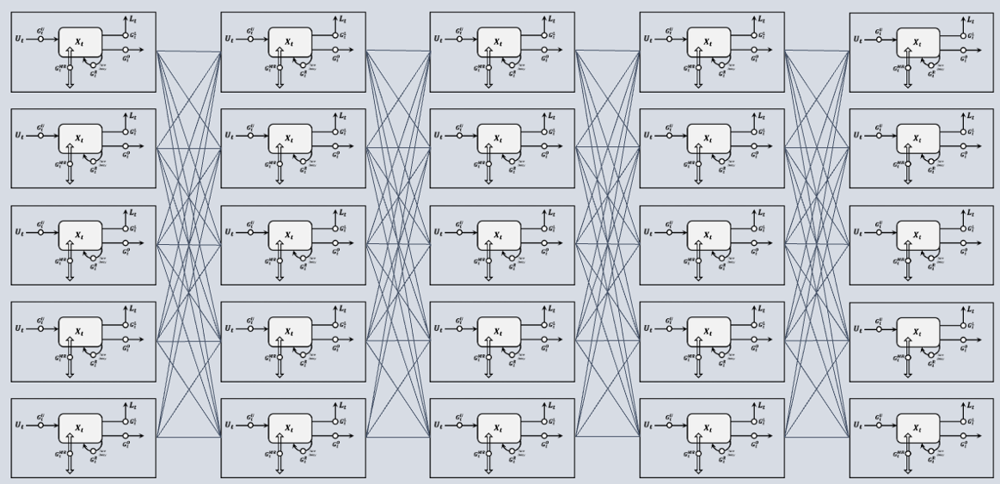

## Mass-Conserving Perceptron (MCP) Neural Network Model Zoo

This repository provides a curated and documented implementation of the neural-network architectures developed in Wang & Gupta (2025), all built around the mass-conserving perceptron (MCP) as the fundamental computational unit, as illustrated in . The original research code was archived at [Zenodo](https://doi.org/10.5281/zenodo.15811866); the version presented here has been subsequently streamlined, refactored, and reorganized for improved readability, reproducibility, and reuse, with assistance from OpenAI's ChatGPT (GPT-6.1 Sol, Max intelligence mode).

Note that this repository includes only the results for the Leaf River Basin and is intended primarily for pedagogical and demonstration purposes. Users interested in reproducing or extending the analyses to the CAMELS-US catchments are encouraged to follow the methodology described in Wang & Gupta (2025) and use the scripts provided in the original [Zenodo](https://doi.org/10.5281/zenodo.15811866).

## Quick Start

### Requirements

Use Python 3.10 and install the dependencies listed in `requirements.txt`, including NumPy, pandas, PyTorch, and scikit-learn. Run the following command from the repository root:

```bash
python -m pip install -r requirements.txt
```

### Leaf River Data

The example data are provided in `20220527-MDUPLEX-LeafRiver/`, the default data directory used by the training and evaluation scripts.

- `LeafRiverDaily_43YR.txt`: daily precipitation (`P`), potential evapotranspiration (`PET`), and streamflow (`Q`), in that column order and all in mm/day.
- `LeafRiverDaily_43YR_Flag.txt`: flags identifying the data subsets used for model spin-up, training, selection, and testing.

| Flag | Data subset |
| ---: | :--- |
| `-99999` | Spin-up |
| `-1` | Training |
| `0` | Selection |
| `1` | Testing |

The data sequence includes three repetitions of water year 1949 for spin-up, followed by the 40-year simulation period covering water years 1949–1988.

### Pretrained Checkpoints

Pretrained Leaf River checkpoints are included in the model folders. They can be used for direct evaluation or as starting points for continued training and fine-tuning.


## References & Citation

Readers should consult the original paper for the formal model names, notation, and mathematical definitions associated with each MCP variant.

- Full article: [Wang & Gupta (2025)](https://agupubs.onlinelibrary.wiley.com/doi/full/10.1029/2025WR040178)
- DOI: [10.1029/2025WR040178](https://doi.org/10.1029/2025WR040178)

> Wang, Y.-H., & Gupta, H. V. (2025). Using machine learning to discover parsimonious and physically‐interpretable representations of catchment‐scale rainfall‐runoff dynamics. *Water Resources Research, 61*(12), e2025WR040178. https://doi.org/10.1029/2025WR040178

## Contact

This repository provides a consolidated and reproducible collection of MCP neural network variants, including cleaned training and evaluation scripts, checkpoints, and data conventions. 

For questions or suggestions, please contact **Yuan-Heng Wang, Ph.D.** at `yhwang0730@gmail.com` or `yhwang0730@arizona.edu`.
